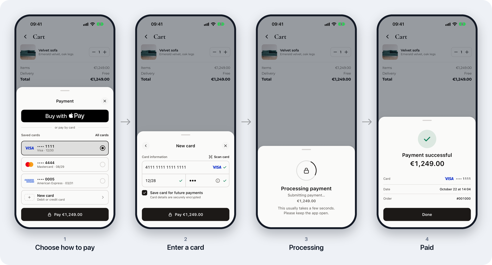

# PAYRDR Mobile SDK

A payment sheet for Android and iOS apps. Your app opens it over its own screen; the buyer pays by card (with 3-D
Secure), with a saved card, Google Pay or Apple Pay, and can scan the card with the camera. The sheet then tells your
app how the payment ended.



## Modules

| Module | What it does | When you need it |
|---|---|---|
| `sdk-payment` | The payment sheet: card form, 3-D Secure, saved cards, Google Pay, Apple Pay | Always |
| `sdk-payment-scanner` | Reads the card number and expiry with the camera ([details](sdk-payment-scanner/README.md)) | Optional |
| `sdk-core` | Checks card data and encrypts it into a token (`seToken`), without any UI | Only if you are PCI DSS certified and keep your own card form |

## Requirements

- Android: minSdk 24, and Kotlin 2.1 or newer in your app (the SDK's Compose Multiplatform 1.10 needs it).
- iOS: 14.0.

## Install

The current release is `4.0.0-beta.4`. All versions are listed on
[GitHub releases](https://github.com/Radarpayments/mobile-sdk/releases).

### Android

The libraries are on Maven Central:

```kotlin
dependencies {
    implementation("io.github.radarpayments:sdk-payment:4.0.0-beta.4")
    implementation("io.github.radarpayments:sdk-payment-scanner:4.0.0-beta.4") // optional: card scanner
    implementation("com.google.android.gms:play-services-wallet:19.4.0") // optional: Google Pay
}
```

You don't need to edit the manifest. The SDK brings the internet permission and its activities, and the scanner brings
the camera permission, marked as not required, so devices without a camera can still install your app.

With Android Gradle Plugin 8.7, lint crashes in release builds on a check of AndroidX Lifecycle 2.9, which the SDK
brings (`Found class …KaCallableMemberCall, but interface was expected`). Turn that one check off:

```kotlin
android {
    lint {
        disable += "NullSafeMutableLiveData"
    }
}
```

For tokenization only, depend on `io.github.radarpayments:sdk-core:4.0.0-beta.4` instead, see
[Your own card form](#your-own-card-form-sdk-core). Each GitHub release also has the AARs.

### iOS

Add the package with Swift Package Manager: File → Add Package Dependencies →
`https://github.com/Radarpayments/mobile-sdk`. It has three products:

| Product | What it is |
|---|---|
| `RadarpaymentsSDKPayment` | the payment sheet, with SDK Core inside |
| `RadarpaymentsSDKScanner` | the card scanner for the sheet; add it next to `RadarpaymentsSDKPayment` |
| `RadarpaymentsSDKCore` | SDK Core alone, for an app with its own payment form |

Take `RadarpaymentsSDKPayment`, plus `RadarpaymentsSDKScanner` if you want the scanner. Then:

```swift
import RadarpaymentsSDKPayment
import RadarpaymentsSDKScanner // only with the scanner
```

For tokenization only, take `RadarpaymentsSDKCore` alone and `import RadarpaymentsSDKCore`, see
[Your own card form](#your-own-card-form-sdk-core). Don't add it to an app that has `RadarpaymentsSDKPayment`: SDK Core
is already in it, and an app can hold only one of the two frameworks. Swift Package Manager downloads every binary of
a package, so it fetches the payment framework too (about 22 MB, once per machine), but only SDK Core goes into your
app.

If you don't use SPM, each release has `RadarpaymentsSDKPayment-<version>.xcframework.zip` and
`RadarpaymentsSDKCore-<version>.xcframework.zip` to embed by hand, and `RadarpaymentsSDKScanner-<version>.zip` with the
scanner's Swift sources to add to your app target.

Two features need setup in Xcode:

- Apple Pay: add the Apple Pay capability with your merchant ID (Signing & Capabilities).
- Card scanner: add `NSCameraUsageDescription` to `Info.plist`. App Store review rejects a build that opens the camera
  without it.

### Flutter and React Native

Each GitHub release has the plugins. See the [Flutter plugin](plugins/flutter/README.md) and the
[React Native module](plugins/react-native/README.md).

## Take a payment

### 1. Your server creates the order

The app never holds the merchant's login, password or API key. Your server registers the order at the gateway and
passes the app one of two things:

- API V1: the server calls `register.do` and gets an `mdOrder`.
- API V2: the server calls `POST /api2/sessions` and gets a session ID (`ps_…`). Set the session's `successUrl` and
  `failureUrl` to `sdk://done` or to your own pages.

Google Pay and Apple Pay appear in the sheet only if the gateway has them enabled for the merchant.

### 2. Open the sheet on Android

Create the checkout when the screen is created — in a field or in `onCreate`. It registers for an activity result, so
the result still reaches you after a screen rotation.

```kotlin
val config = SdkPaymentConfig(
    baseUrl = "https://dev.bpcbt.com/payment",
    googlePay = GooglePayConfig(), // optional; everything else comes from the gateway and the order
    cardScannerProvider = MlKitVisionCardScannerProvider(), // optional; needs sdk-payment-scanner
)

class CartActivity : AppCompatActivity() {
    private val checkout = PayrdrCheckout.Builder(config) { result -> handle(result) }.build(this)

    fun onPayClick(mdOrder: String) = checkout.present(mdOrder)
}
```

For API V2, call `checkout.presentSession(sessionId)` instead.

In Compose, use `val checkout = rememberPayrdrCheckout(config) { result -> handle(result) }`. From a plain `Activity`,
start `PayrdrCheckoutIntent` with `startActivityForResult`.

### 2. Open the sheet on iOS

Call it on the main thread, and keep a reference to `PayrdrCheckout` while the sheet is open.

```swift
import RadarpaymentsSDKPayment
import RadarpaymentsSDKScanner // only with the scanner

let config = SdkPaymentConfig(
    baseUrl: "https://dev.bpcbt.com/payment",
    applePay: ApplePayConfig(merchantId: "merchant.com.example"), // optional
    cardScannerProvider: MlKitVisionCardScannerProvider() // optional; needs RadarpaymentsSDKScanner
)
let checkout = PayrdrCheckout(config: config)

checkout.present(mdOrder: mdOrder, from: viewController) { result in handle(result) }
```

There is also an async version: `let result = try await checkout.present(mdOrder: mdOrder, from: viewController)`.
For API V2, call `checkout.presentSession(sessionId: sessionId, from: viewController) { result in … }`.

In SwiftUI, use the modifier `.payrdrCheckout(isPresented: $paying, mdOrder: mdOrder, config: config) { result in … }`.
It takes an `mdOrder` only; open an API V2 session with `presentSession`.

### 3. Handle the result

The result has one of four types, and each carries the `orderId`.

```kotlin
when (result) {
    is CheckoutResult.Completed -> showPaid(result.orderId)
    is CheckoutResult.Failed -> showDeclined(result.error) // the payment did not happen
    is CheckoutResult.Canceled -> Unit // the buyer closed the sheet
    is CheckoutResult.Unknown -> checkOnServer(result.orderId) // sent, but the outcome is not known
}
```

In Swift: `switch onEnum(of: result) { case .completed(let paid): … }`.

Don't release the goods on the result alone: ask your server for the order status. After `Unknown`, don't offer to pay
again until the server knows how the order ended.

## Your own card form (SDK Core)

If you are PCI DSS certified and collect card data in your own form, SDK Core checks the data and encrypts it into a
token (`seToken`). Your server sends the token to the gateway in place of the card. SDK Core has no UI and makes no
network calls. Add `io.github.radarpayments:sdk-core` on Android or the `RadarpaymentsSDKCore` product on iOS
([Install](#install)).

On Android:

```kotlin
import net.payrdr.mobile.payment.sdk.core.SdkCore
import net.payrdr.mobile.payment.sdk.core.model.CardParams
import net.payrdr.mobile.payment.sdk.core.model.SdkCoreConfig

val result = SdkCore().generate(
    SdkCoreConfig(
        cardParams = CardParams(
            mdOrder = mdOrder,
            pan = "4111111111111111",
            cvc = "123",
            expiryMMYY = "12/30",
            cardHolder = "JOHN DOE", // or null if your form doesn't ask for it
            pubKey = publicKey,
        ),
        timestamp = System.currentTimeMillis(),
    ),
)
val token = result.token
if (token != null) {
    sendToYourServer(token)
} else {
    result.errors.forEach { (field, code) -> showError(field, code) } // e.g. ParamField.PAN to "invalid"
}
```

On iOS:

```swift
import RadarpaymentsSDKCore

let params = CardParams(
    mdOrder: mdOrder,
    pan: "4111111111111111",
    cvc: "123",
    expiryMMYY: "12/30",
    cardHolder: "JOHN DOE", // or nil if your form doesn't ask for it
    pubKey: publicKey
)
let config = SdkCoreConfig(
    cardParams: params,
    timestamp: Int64(Date().timeIntervalSince1970 * 1000)
)
let result = SdkCore().generate(config: config)
if let token = result.token {
    sendToYourServer(token)
} else {
    for (field, code) in result.errors { showError(field, code) } // e.g. .pan: "invalid"
}
```

`timestamp` is the current time in milliseconds. It goes into the token, and the card's expiry is checked against it.

**The public key.** Get it from `{baseUrl}/se/keys.do`, for the sandbox `https://dev.bpcbt.com/payment/se/keys.do`.
The answer is `{"keys": [{"keyValue": "-----BEGIN PUBLIC KEY-----…", "protocolVersion": "RSA", "keyExpiration": …}]}`;
pass `keyValue` as it is. The key has an expiry date (`keyExpiration`, milliseconds), so fetch it rather than build
it into the app.

**Which parameters.** Each class is one kind of payment:

| Class | Use it for |
|---|---|
| `CardParams` | a new card, for an order (`mdOrder` from `register.do`) |
| `BindingParams` | a saved card (`bindingID`), for an order; `cvc` may be `null` when the gateway doesn't ask for it |
| `CardInstantParams`, `BindingInstantParams` | the same without an order (instant payment) |
| `NewPaymentMethodCardParams`, `NewPaymentMethodStoredCardParams` | creating a payment method; a stored one is `pm_…` |

**Errors.** `generate` checks the fields in the order a form shows them — card number, expiry, CVC, cardholder, order,
key — and stops at the first wrong one, so `errors` holds one entry: the field (`ParamField`) and a code
(`ValidationCodes`):

| Code | Means |
|---|---|
| `required` | the field is empty |
| `invalid-format` | wrong characters or shape: letters in the card number, expiry not `MM/YY`, cardholder not Latin letters |
| `invalid` | the value is wrong: card number length or checksum, month 13 or a month that has passed, CVC not 3–4 digits, a key that can't be read |

`ParamField.UNKNOWN` with `unknown` means the encryption failed for another reason.

## Configuration

Besides `baseUrl`, the wallets and the scanner, `SdkPaymentConfig` takes:

| Parameter | What it does |
|---|---|
| `locale` | The sheet's language, e.g. `"de"`. By default it follows the device. |
| `theme` | `PaymentTheme.System` (default), `Light`, `Dark`, or `Custom` with your colours (`PaymentColor(0xFF1F4FD8)`), text styles and corners (`PaymentCorners.Radius(12f)`, `PaymentCorners.Pill`). |
| `showResultScreen` | `true`: the SDK shows its own success or decline screen and returns the result after the buyer taps Done. Off by default. |
| `logTransport` | Where the SDK's logs go. The SDK has no crash reporter; plug yours in here. |
| `sslPinning` | Certificate pinning for the gateway. Off by default: the system trust store is used. |
| `keyProviderUrl` | Where to get the gateway's public keys. Defaults to `{baseUrl}/se/keys.do`. |

The sheet is translated into English, Russian, Romanian, Greek, Bulgarian, German, French, Spanish and Arabic (right
to left). Amounts are written the way the language writes them: `€1,234.50` in English, `1.234,50 €` in German.

## Versions

Betas, release candidates and stable versions are on Maven Central and SPM. Take a beta or a release candidate
(`4.1.0-beta.1`, `4.1.0-rc.1`) only by writing its exact version. Alphas are on GitHub only; each alpha release
includes a Maven repository as a zip.

## More documentation

- [Card scanner](sdk-payment-scanner/README.md)
- [Flutter plugin](plugins/flutter/README.md) and [React Native module](plugins/react-native/README.md)
- [The JSON contract behind the plugins](sdk-bridge/README.md)
- [Sample apps](samples/README.md)

To work on the SDK itself, start with [AGENTS.md](AGENTS.md): the toolchain, the build commands and the rules.

## License

[MIT](LICENSE.md) © BPC
